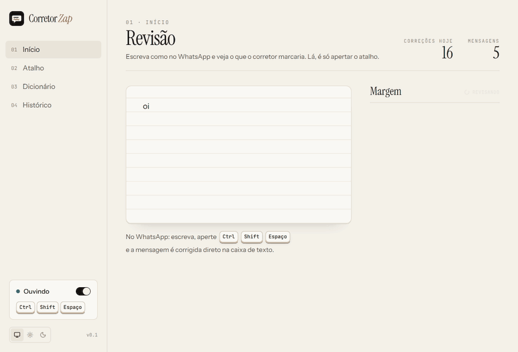
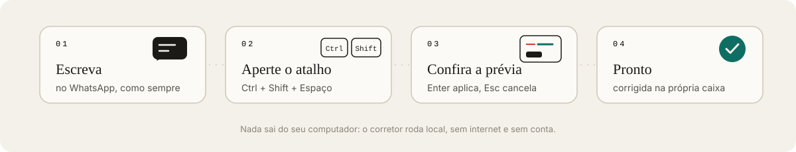
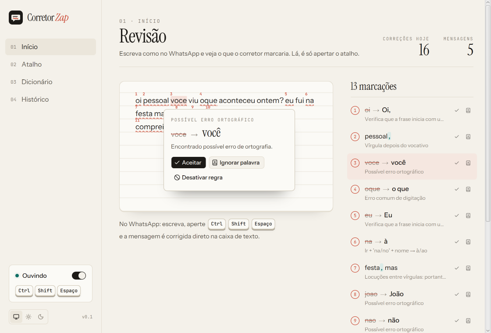
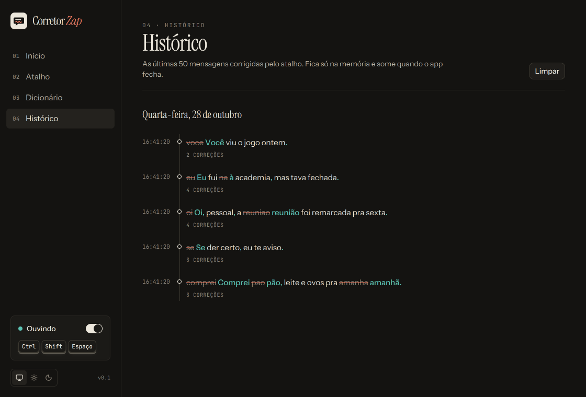
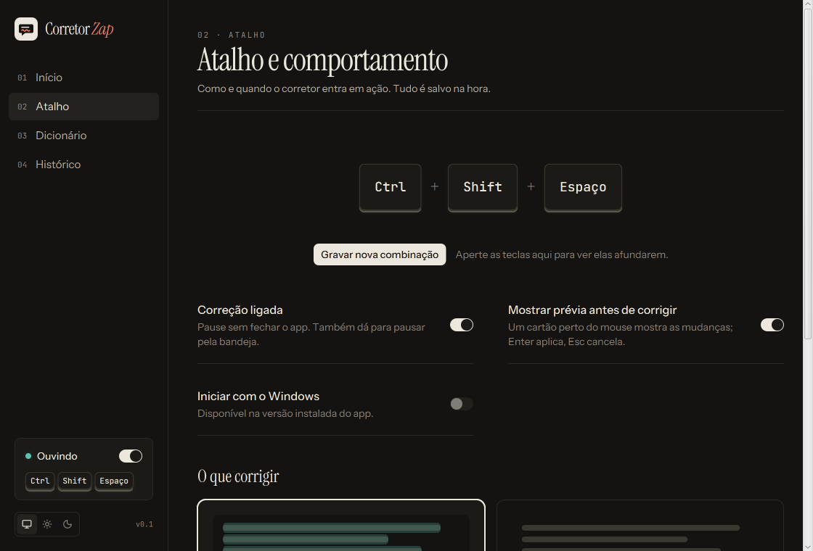
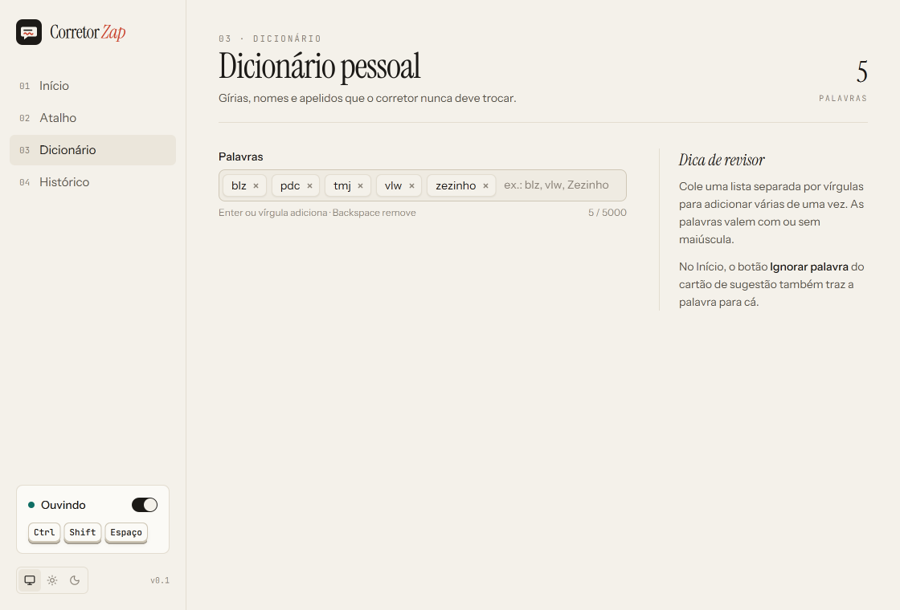
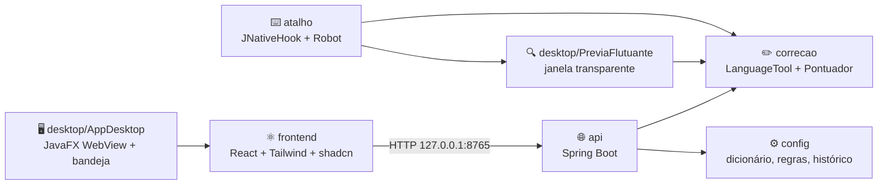

<div align="center">



<br>


<br>


**Escreveu, apertou, corrigiu.**
Corretor de ortografia e pontuação para o WhatsApp Desktop e Web: escreva a mensagem,
aperte `Ctrl + Shift + Espaço` e confira a prévia antes de enviar. Roda inteiro no seu computador.

<a href="https://github.com/MatheusEB/corretor-zap/releases/latest"></a>

</div>

---

<div align="center">
  
  <br>
  <sub>Telas com os <b>dados de demonstração</b> (<code>--corretor.demo=true</code>). Nenhuma conversa de verdade aparece aqui.</sub>
</div>

## Do rascunho à mensagem enviada



| | Etapa | O que o programa faz |
|---|---|---|
| ✍️ | **Escrever** | Você digita no WhatsApp normalmente, sem colar o texto em lugar nenhum. |
| ⌨️ | **Atalho** | `Ctrl + Shift + Espaço` copia o texto da caixa em foco. A sua área de transferência é guardada e devolvida no fim. |
| 🔍 | **Prévia** | Um cartão flutua por cima do WhatsApp com cada correção marcada (riscado → novo). Clique numa correção para desfazê-la. |
| ✅ | **Aplicar** | `Enter` devolve o foco ao WhatsApp e troca o texto pela versão corrigida. `Esc` cancela sem mexer em nada. |

<div align="center">
  
</div>

## Destaques

<table>
<tr>
<td width="50%" valign="top">

### ✏️ Ortografia e acentos
O [LanguageTool](https://languagetool.org) em português do Brasil, ajustado para conversa: `voce` → `você`, `nao` → `não`, `porisso` → `por isso`, sem "corrigir" risada nem gíria.

### 🔤 Pontuação de chat
Uma camada própria (`Pontuador`) põe vírgula depois de saudação e vocativo (`oi joao tudo bem` → `Oi, João, tudo bem?`), ponto final e interrogação. Cada tipo liga e desliga na página Atalho.

### 📖 Dicionário seu
Gírias, apelidos e nomes que o corretor nunca deve mexer. Também dá para desligar uma regra direto pelo cartão da sugestão.

</td>
<td width="50%" valign="top">

### 🖥️ App de mesa de verdade
Janela própria com o painel em React, ícone na bandeja (Abrir, Pausar, Sair) e **Iniciar com o Windows**. Fechar a janela só esconde; o corretor continua ativo.

### 🌗 Folha de Revisão
O visual imita uma folha corrigida à caneta: sublinhado ondulado ao vivo, marcações numeradas na margem, teclas 3D que afundam com as de verdade. Tema claro e escuro, sem gradiente nem brilho.

### 🔒 Fica no seu computador
Nada vai para a internet. O servidor só aceita a própria máquina (`127.0.0.1`), bloqueia pedidos de outros sites e o histórico fica em `~/.corretor-zap`.

</td>
</tr>
</table>

<div align="center">
<table>
<tr>
<td></td>
<td></td>
</tr>
<tr>
<td align="center"><sub>Início · tema claro</sub></td>
<td align="center"><sub>Histórico · tema escuro</sub></td>
</tr>
<tr>
<td></td>
<td></td>
</tr>
<tr>
<td align="center"><sub>Atalho · tema escuro</sub></td>
<td align="center"><sub>Dicionário · tema claro</sub></td>
</tr>
</table>
</div>

## Como é feito



- **`correcao`** junta o LanguageTool (ortografia e acentos) com o `Pontuador` (vírgulas e fim de frase) e filtra o que não faz sentido em chat.
- **`atalho`** escuta o atalho global e lê/escreve a caixa em foco com `Ctrl+A`, `Ctrl+C` e `Ctrl+V` simulados, guardando a área de transferência antes.
- **`desktop`** abre o painel numa janela nativa (JavaFX WebView) e a prévia numa janela transparente por cima do WhatsApp, com JNA para o foco das janelas no Windows.
- **`frontend`** é compilado para dentro do jar (`backend/src/main/resources/static`), então o app é um único executável.

<details>
<summary><b>📁 Estrutura das pastas</b></summary>

```
corretor-zap/
├── backend/                 Spring Boot (Java 21)
│   └── src/main/java/com/corretorzap/
│       ├── api/             endpoints do painel
│       ├── atalho/          atalho global e leitura/escrita da caixa em foco
│       ├── config/          configuração, dicionário e regras
│       ├── correcao/        LanguageTool, Pontuador e histórico
│       ├── demo/            dados de demonstração
│       ├── desktop/         janela, bandeja, prévia flutuante, Windows (JNA)
│       ├── seguranca/       filtro que só aceita a própria máquina
│       └── web/             CORS e cabeçalhos de segurança
├── frontend/                React + TypeScript + Vite + Tailwind + shadcn
│   └── src/
│       ├── paginas/         Início, Atalho, Dicionário, Histórico
│       ├── previa/          cartão de prévia flutuante
│       └── components/      editor de revisão, notas da margem, teclas
├── packaging/               empacotar.cmd (jpackage) e ícone
├── testes-carga/            estresse, bateria de pontuação e teste do atalho
└── iniciar.cmd              roda a partir do código
```

</details>

## Instalar

1. Baixe o **`CorretorZap-windows.zip`** na [última versão](https://github.com/MatheusEB/corretor-zap/releases/latest).
2. Extraia a pasta onde quiser e abra **`Corretor Zap.exe`**. O Java já vem dentro.

> [!NOTE]
> O executável não tem assinatura digital, então o Windows pode mostrar "O Windows protegeu o computador". Clique em **Mais informações** e depois em **Executar assim mesmo**.

## Rodar a partir do código

Precisa de **JDK 21+** e **Node 20.19+** (ou 22.12+).

```bat
iniciar.cmd
```

Na primeira vez ele compila o painel e o backend, e depois abre a janela e o ícone na bandeja.

Para gerar o app portátil, com o Java embutido (quem baixar não precisa instalar nada):

```bat
packaging\empacotar.cmd
```

O resultado fica em `dist\Corretor Zap\Corretor Zap.exe` e `dist\CorretorZap-windows.zip`.

> [!NOTE]
> Para ver o app com dados de exemplo, sem tocar na sua configuração:
> `java -jar backend/target/corretor-zap-0.0.1-SNAPSHOT.jar --corretor.demo=true --server.port=8766 --corretor.config-dir=<pasta temporária>`

## Testes

```bash
cd backend
./mvnw test
```

São **59 testes** (JUnit 5): correção, pontuação (33 casos de mensagens reais), API, atalho, dicionário, concorrência e o filtro de segurança.

Com o app aberto, os testes de `testes-carga/` medem o resto:

```bash
node testes-carga/pontuacao.mjs    # bateria de mensagens de chat → como o corretor devolve
node testes-carga/estresse.mjs     # 200 usuários simultâneos, textos de 20 mil caracteres
```

## Privacidade

- A correção roda **no seu computador**. Nenhum texto vai para servidor nenhum.
- O painel só responde para `127.0.0.1`: ninguém na sua rede Wi-Fi, nem um site aberto no navegador, consegue ler o histórico.
- O corretor não lê as suas conversas. Ele só vê o texto da caixa de mensagem quando você aperta o atalho.

## Licença

[MIT](LICENSE) para o código deste repositório. O app usa bibliotecas com licenças próprias, que continuam valendo:

| Biblioteca | Para quê | Licença |
|---|---|---|
| [LanguageTool](https://github.com/languagetool-org/languagetool) 6.8 | ortografia em pt-BR | LGPL 2.1 |
| [JNativeHook](https://github.com/kwhat/jnativehook) 2.2.2 | atalho global | LGPL 3 (ou GPL 3) |
| [OpenJFX](https://openjfx.io) 23 | janela e WebView | GPL 2 com Classpath Exception |
| [JNA](https://github.com/java-native-access/jna) 5.12 | foco das janelas no Windows | Apache 2.0 (ou LGPL 2.1) |
| [Spring Boot](https://spring.io/projects/spring-boot) 4.1 | servidor local | Apache 2.0 |

---

<div align="center">
<sub>Feito para escrever certo sem parar a conversa</sub>
</div>
